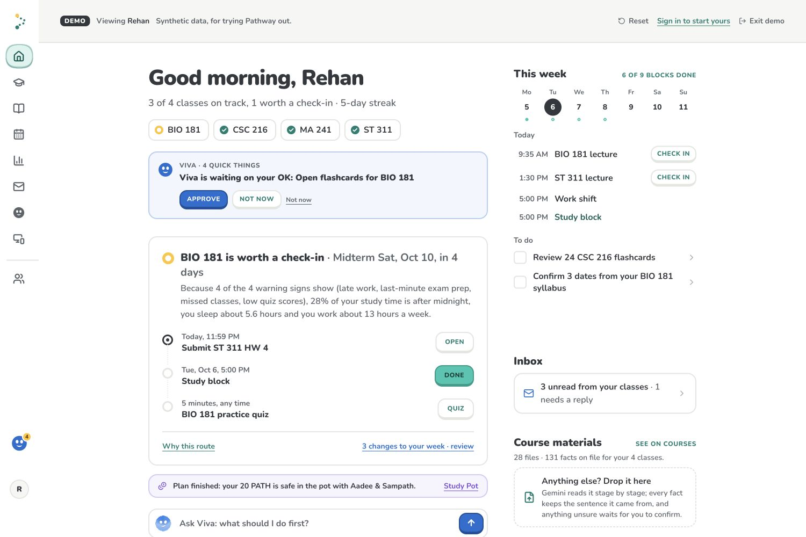
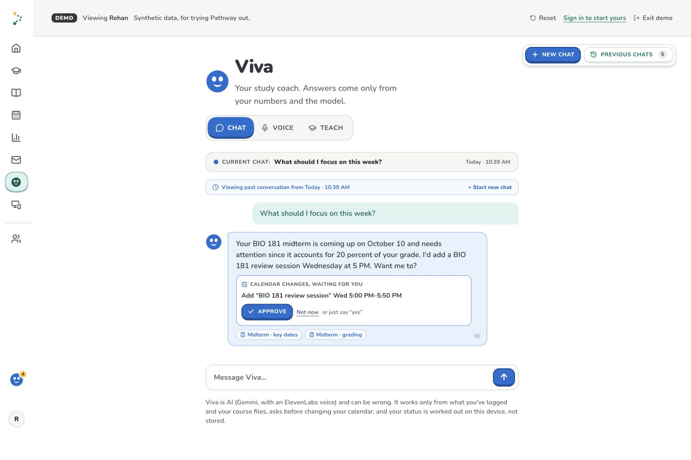
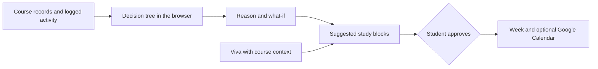

# Pathway

**Know your next move.** Pathway brings course activity, uploaded materials, and a student's week into one place. It explains *why* a course may need attention, suggests a concrete next step, and helps put that step on the calendar. Viva, the assistant students can chat or speak with, carries that course context across the app.

This is a hackathon prototype. Its decision trees were trained on synthetic student data, so their predictions are demonstrations of the product, not validated academic outcomes.



## Try the demo

```bash
npm install
npm run dev
```

Open [localhost:3000/demo](http://localhost:3000/demo) for Rehan's synthetic sample semester. The core demo works without API keys or a database; live AI, voice, Google services, and persistence need their respective configuration below. The [landing page](http://localhost:3000/landing) is separate from the app.

The [Devpost gallery](devpost-media/README.md) shows the overview, model path, Viva's proposed action, and a source-based quiz.

Outside demo mode, Pathway asks visitors to sign in with Google. Account sign-in requires a database, a Google OAuth web client ID, and a session secret; see [Configuration](#configuration).

### iPhone demo

Open the deployed site's `/demo` URL in Safari, then choose **Share → Add to Home Screen**. The installed app launches into the demo with the Pathway icon. It uses five bottom tabs: Home, Study, Week, Viva, and More. More contains Courses, Insights, Inbox, and Buddies; Beacon is available in desktop navigation. The app needs an internet connection.

Phone layouts account for the home indicator and landscape safe areas. Text fields keep Safari from zooming on focus, and Viva adjusts to the visible viewport when the keyboard opens. Before presenting, check the installed app on the target iPhone, especially Viva voice permissions and the keyboard.

## What Pathway does

- **Shows the reason.** An on-device decision tree checks course signals and displays the path behind its result. Insights also shows what could change the result and the evidence behind the prototype model.
- **Makes a plan.** The Week page puts classes, due dates, and study blocks together. Suggestions wait for approval before changing the calendar.
- **Helps you study.** Course materials can become quizzes, flashcards, and explanations. Viva supports chat and voice, can use relevant course context, and can propose actions such as adding or moving a study block.
- **Keeps the source visible.** Uploaded syllabi, notes, and grade pages become reviewable facts with source references. Uncertain facts wait for the student to check them.
- **Connects the rest of the semester.** Pathway includes a course-focused inbox, study buddies, Pathway Beacon (a Raspberry Pi desk companion), and optional Study Pots on Solana devnet.



*Viva can suggest the next step from course context. The student approves a calendar change before it happens.*

### What connects today

| Service | Current behavior |
| --- | --- |
| Moodle and Gradescope | Sample records are included in the demo. Students can drop their own syllabus or grade page; there is no direct account sync yet. |
| Google Drive | An optional Google Picker lets a student choose course files to import. It needs Google OAuth and a browser API key. |
| Google Calendar | An optional shared demo calendar or a student's personal calendar can sync events and approved study blocks. |
| Gmail | Viva can draft a reply and open it in Gmail for the student to send. The inbox currently uses sample mail; Pathway does not send mail itself. |
| Gemini | Powers Viva, document analysis, study material generation, and planning when an API key is configured. The decision tree itself does not call Gemini. |
| ElevenLabs | Handles Viva speech-to-text and text-to-speech when configured. |

## How it works

1. **Collect signals.** Pathway uses sample or uploaded course records, logged quizzes and check-ins, upcoming work, and an optional connected calendar.
2. **Explain the check-in.** Python trains and exports the decision trees offline. The browser runs the exported JSON model and shows its decision path; there is no Python server.
3. **Choose a next step.** Rule-based suggestions and Gemini planner proposals appear in the same review flow. Suggested calendar changes wait for approval; direct commands to Viva leave a receipt in the conversation.
4. **Keep studying.** New activity is logged. When an actual model input changes, the browser re-scores the course; completing a study block alone does not guarantee a status change. Viva can answer with course context and leave a receipt for actions it takes in the app.



The database, when configured, stores student inputs and app state. The decision tree runs in the browser; no dedicated database field stores the course-status result. Planning and chat can send course context to Gemini, and voice mode sends speech to ElevenLabs.

## Built with

Next.js 16, React 19, TypeScript, and Tailwind CSS power the app. Python and scikit-learn train the exported decision trees. Optional services include Gemini for Viva and planning, ElevenLabs for voice, Tiger Cloud for persistence, Google Drive and Calendar, and Solana devnet for Study Pots.

## Model evidence

On a held-out set of 160 synthetic records, the early tree (before a midterm score) caught 32 of 44 below-C outcomes: 73% recall, 63% precision, and 19 false alarms. The separate mid-semester tree caught 41 of 44: 93% recall, 62% precision, and 25 false alarms. These are prototype results, not evidence of accuracy on real students. We report both test-set looks in [the full model results](notebooks/RESULTS.md); an independent real-world evaluation is still needed.

## Responsible AI

- **The check-in supports, it doesn't judge.** Statuses are only "on track" or "worth a check-in", with the decision-tree path and a modeled change among supported, actionable inputs. That change crosses a model boundary; it is not proof that following the plan will improve a grade. Pathway does not suggest changing context such as work hours, and the percentage shown describes similar records in the synthetic data, not a personal prediction.
- **Limits are stated in the app.** The model learned patterns, not causes, from synthetic data; it was trained on end-of-semester totals, so early-semester use isn't validated; its recall is weaker for small groups such as seniors. Insights shows the held-out evaluation and a model card.
- **Privacy.** The decision tree computes status in the browser; Pathway has no dedicated status column in its database. The database does store inputs and shared app state, including courses, activity, study blocks, and chats. Gemini can receive course status and reasons along with the course numbers, files, or messages needed for planning and conversation. ElevenLabs processes Viva's speech. Beacon camera frames are interpreted by a cloud service but are not kept by Pathway or used to score a course.
- **The student stays in control.** Uncertain facts from uploaded files wait for confirmation, and Viva asks before any calendar change. Pathway never sends email for the student.
- **AI use is disclosed.** In the product: Gemini (Google) and ElevenLabs, labelled where they're used. In building it: the team used AI coding assistants, including Claude Code (Anthropic), for writing, reviewing and auditing code.

## Configuration

Copy `.env.example` to `.env.local` when you want to enable services. Replace its placeholders; if you are not using Tiger Cloud, remove the example `DATABASE_URL` value.

| To enable | Set in `.env.local` | Notes |
| --- | --- | --- |
| Google account sign-in | `DATABASE_URL`, `NEXT_PUBLIC_GOOGLE_CLIENT_ID`, `SESSION_SECRET` | Set up the schema with `npm run db:setup`. The OAuth client must allow your local or deployed origin. |
| Viva and document analysis | `GEMINI_API_KEY` | `GEMINI_MODEL_FAST` and `GEMINI_MODEL` can override the defaults. |
| Viva voice | `ELEVENLABS_API_KEY` | `ELEVENLABS_VOICE_ID` is optional. Keep the API key server-side. |
| Google Drive Picker | `NEXT_PUBLIC_GOOGLE_CLIENT_ID`, `NEXT_PUBLIC_GOOGLE_API_KEY` | Enable the Google Picker and Drive APIs for the project. |
| Personal Google Calendar | `NEXT_PUBLIC_GOOGLE_CLIENT_ID` | Connect from the app through Google OAuth. |
| Shared demo calendar | `GOOGLE_SERVICE_ACCOUNT_JSON`, `GOOGLE_CALENDAR_ID` | Share the calendar with the service account. Automatic reconciliation manages Pathway-tagged entries; a student-requested edit can also change another event. `GOOGLE_FAKE_CALENDAR=1` provides an in-memory local stand-in. |
| Study Pots | `SOLANA_AUTHORITY_SECRET`, `WALLET_ENCRYPTION_KEY`, `PATH_MINT` | Uses Solana devnet; see [docs/solana](docs/solana/README.md). |

**One clock.** Every time the browser keeps is a local wall-clock string without a zone (`src/lib/time.ts`): data from the database or a model is converted on the way in, and study blocks go to the database as UTC instants. Blocks write through on every add, move, rename or removal, and a reload merges rather than replaces.

**Demo account.** The demo student is Rehan (profile id `maya`, which keys the rows, the seeded facts and the Google tags). A Google account listed in `DEMO_ACCOUNT_EMAILS` (comma-separated; defaults to the team's demo account) signs in as that profile (`DEMO_ACCOUNT_PROFILE`): the account and `/demo` are one profile, so courses, files, facts, study blocks, chats and the Google calendar are the same seen either way, and a change made in one shows in the other (`src/lib/demoAccount.ts`). `/demo` offers only that profile (the other sample students stay in the database as study buddies), it stays open to visitors while the account points at it, every sign-in re-adds anything the seed is missing, and deleting the demo account only unlinks it. What used to live only in one browser (Viva chats, suggestions set aside, demo events moved or removed, notes, study material) is kept per profile as one document (`/api/extras`, table `profile_extras`) and merged on load, and files dropped on one device are merged into the graph everywhere (`GET /api/knowledge`). If the shared calendar (`GOOGLE_CALENDAR_ID`) is that account's own, it is connected for it with no OAuth step.

**Viva actions.** Calendar changes appear on a review card and run only after approval by button, text, or voice. Study tools a student directly asks Viva to open can start immediately; tools Viva offers wait for approval. Completed actions leave a receipt in the conversation.

For database setup and the pooled Vercel connection string, see [docs/database](docs/database/README.md). Never commit `.env.local` or service-account keys.

## Useful commands

```bash
npm run dev       # local app
npm test          # unit tests
npm run lint      # ESLint
npm run build     # production build
npm run db:setup  # create database schema, when DATABASE_URL is configured
npm run db:check  # check database setup
```

## Where to look in the code

| Area | Key files |
| --- | --- |
| Model and evidence | `notebooks/pathway_model.py`, `notebooks/RESULTS.md`, `public/models/`, `src/lib/tree.ts`, `src/lib/features.ts` |
| Demo and app state | `src/lib/mock.ts`, `src/lib/data.ts`, `src/lib/store.tsx`, `src/app/demo/` |
| Course materials | `src/lib/knowledge/`, `src/app/courses/`, `src/app/study/` |
| Viva and voice | `src/lib/intel/`, `src/components/Viva.tsx`, `src/components/VivaDock.tsx`, `src/lib/voice.ts` |
| Calendar | `src/lib/schedule.ts`, `src/lib/gcal.ts`, `src/app/calendar/` |
| Database and API | `db/schema.sql`, `scripts/db.ts`, `src/app/api/` |
| Pathway Beacon | `src/app/device/`, `scripts/kiosk.sh`, [hardware setup](docs/hardware/README.md) |

The [planning notes](docs/planning/README.md) document earlier ideas and decisions; the code and this README describe the current prototype.
