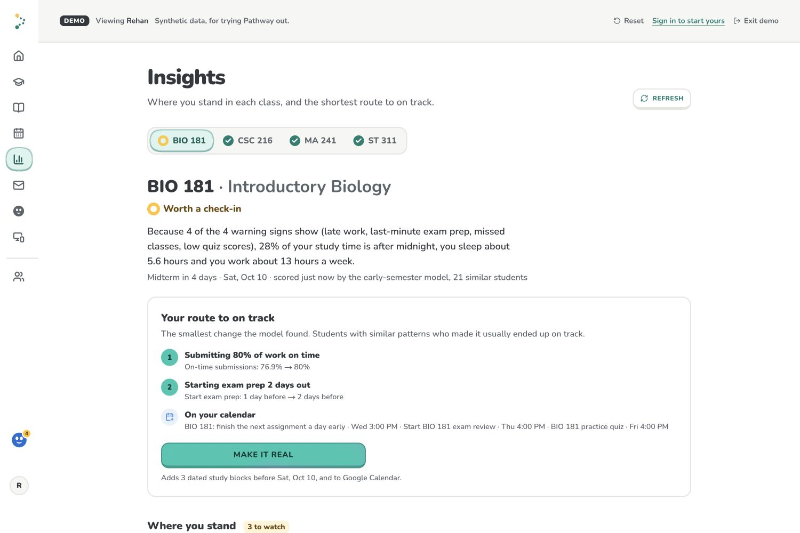
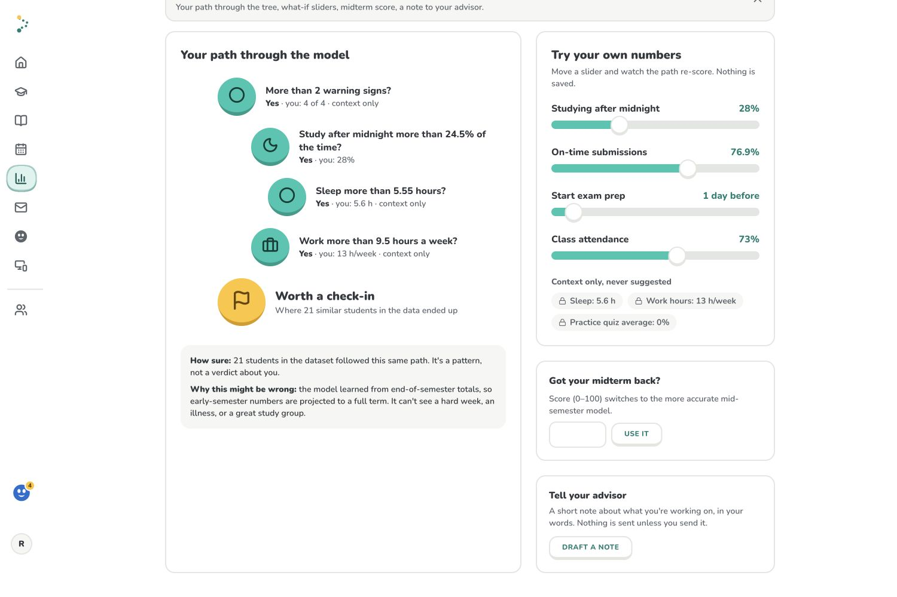
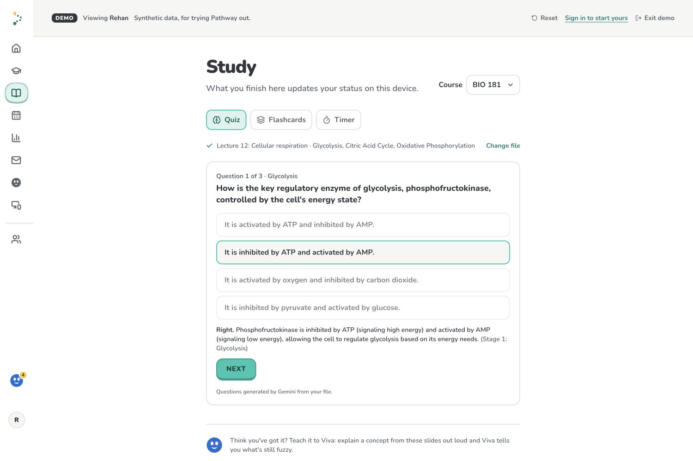

# Pathway

Pathway is a student planning and study-support prototype built at WolfHacks 2026. This repository is a public archive of that hackathon project.

**Know your next move.** Pathway brings course activity, uploaded materials, and a student's week into one place. It explains why a course may need attention, suggests a next step, and helps the student plan time for it. Viva is an assistant that can use course context and propose actions for the student to review.

This is a prototype, not a maintained student service. Its sample students, course records, and model data are synthetic. The model results below are demonstrations and are not validated academic predictions.

<details>
<summary>View project screenshots</summary>

### Semester overview


### From a check-in to a plan



### Explainable model



### Viva proposes an action


### Source-based quiz



</details>

## Run the demo

```bash
npm install
npm run dev
```

Open [localhost:3000/demo](http://localhost:3000/demo) for a synthetic sample semester. The core demo runs locally without API keys or a database. Optional AI, voice, Google services, and persistence features require external service configuration and may not work in a fresh checkout.

The [demo gallery](devpost-media/README.md) includes screenshots of the semester overview, model explanation, Viva action proposal, and source-based quiz.

## What it demonstrates

- An interpretable decision tree that runs in the browser and shows the path behind its check-in.
- A weekly plan that combines classes, deadlines, and study blocks.
- Study tools that use course materials to create quizzes, flashcards, and explanations.
- Viva, which can use course context and propose calendar actions for the student to approve.
- Optional integrations, including Google Drive and Calendar, Gemini, ElevenLabs, and Solana devnet Study Pots.

## Model evidence and limits

On a held-out set of 160 synthetic records, the early tree caught 32 of 44 below-C outcomes (73% recall, 63% precision, 19 false alarms). The mid-semester tree caught 41 of 44 (93% recall, 62% precision, 25 false alarms). These results describe synthetic data only; they do not show that the model predicts real student outcomes or that following its suggestions improves grades. See [the evaluation results](notebooks/RESULTS.md).

The tree computes its check-in in the browser. Other features have different data flows: when configured, the database stores student inputs and app state, Gemini can receive course context for planning and conversation, and ElevenLabs processes Viva speech. The prototype is not fully on-device.

## Built with

Next.js, React, TypeScript, Tailwind CSS, Python, and scikit-learn. Optional integrations use Gemini, ElevenLabs, Tiger Cloud, Google Drive and Calendar, and Solana devnet.

## License

Pathway is proprietary. See [LICENSE](LICENSE). Third-party components remain under their own licenses.
